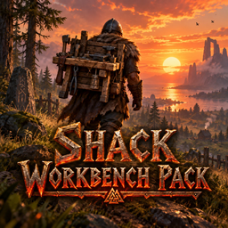

# Shack Workbench Pack

**[Download on Thunderstore](https://thunderstore.io/c/valheim/p/TheShackDev/Shack_Workbench_Pack/)** · version 1.2.0 · part of [The Shack Pack](https://thunderstore.io/c/valheim/p/TheShackDev/The_Shack_Pack/)

A **workbench you carry on your back**. Craft it at the workbench, upgrade it there like gear, then take it with you: wear it and press **Tab** to craft, upgrade and repair right from your back, or set it down anywhere as a small workbench you can work at.

## Getting one

- Craft the **Workbench backpack** at a workbench: **10 Wood + 2 Deer hide**.
- **Upgrade it** at a workbench, in the Upgrade tab, from level 1 to 5. Each upgrade costs exactly what the matching workbench upgrade costs to build:

| Level | Packs | Upgrade costs |
|---|---|---|
| 2 | Chopping block | 10 Wood, 10 Flint |
| 3 | Tanning rack | 10 Wood, 15 Flint, 20 Leather scraps, 5 Deer hide |
| 4 | Adze | 10 Fine wood, 3 Bronze |
| 5 | Tool shelf | 4 Iron, 10 Fine wood, 4 Obsidian |

- Like any gear, upgrading to level N needs a workbench of level N, so you can only pack an upgrade after your real bench has it.
- The costs are read from the game's own workbench upgrades, so they always match.
- Upgrading gives you a fully repaired backpack, and keeps its stonecutter if it has one.

## Wearing it

- It goes in the **utility slot** (where Megingjord or the Wishbone go): right-click it in your inventory.
- It **weighs 30**, and while it's **anywhere in your inventory** (worn or in your bag) you walk, run and swim **15% slower**. In a cart or a chest it doesn't slow you. A Forge backpack adds its own 15% (30% with both).
- A small workbench shows **on your back**, for everyone to see.
- **Tab** opens the workbench menu at the backpack's level, next to your inventory: craft, upgrade and repair on the go.
- The **hammer** can build around you, like near a real workbench (20 m at level 1, +4 m per level).

## Setting it down

- **In your hotbar or a quick slot:** press its key. **While you wear it:** press **U** (you can change the key in F1; Alt+U is left to other mods).
- A ghost of the bench shows where you aim. **Left-click** sets it down, **scroll** turns it, **right-click** cancels.
- The set-down bench is a **half-width, three-quarter-height workbench**. It works like a workbench of the backpack's level: crafting, upgrades, repairs, and building around it.
- **Shift + E** packs it back up. Like equipping gear it takes a moment (the equipping animation and its progress bar); walking away or attacking stops it. It comes back at the same level and durability, with its stonecutter, straight onto your back if your utility slot is free.
- Removing it with the hammer, or it getting destroyed, **drops the backpack** (at its level) instead of losing it.
- Only the player who set it down (or an admin) can pack it up or remove it. Wards and no-build areas apply as usual.

## Durability

- The backpack has **durability**, more at each level: **100** at level 1, **+50** per level (300 at level 5).
- Every **craft, upgrade or repair done at it** (worn or set down) uses **1**. A set-down bench keeps its durability and shows it when you look at it.
- **Broken** (0), it does nothing: it falls off your back, can't be worn or set down, and a set-down one won't open. You can still pack a set-down one up.
- **Repair it at another workbench of at least its level:** a real workbench, or another backpack bench. It can't repair itself.

## Stonecutter

- At a real **stonecutter**, the **Craft** tab has **Backpack stonecutter**. With a Workbench backpack in your inventory, it costs what building a stonecutter costs (**10 Wood, 2 Iron, 4 Stone**) and packs a stonecutter into the backpack (the one you wear first).
- The backpack gets **10 heavier** (60), and **stone pieces** can be built around it, worn or set down (20 m, like a real stonecutter).
- Working at it, the crafting panel shows **Workbench + Stonecutter** with both icons, and a small stonecutter stands beside the set-down bench.
- A full inventory doesn't stop it: the stonecutter goes into the backpack, not your bag.
- With **Shack Recycler**, recycling the backpack gives the stonecutter's materials back too.

## Forge backpack

- A **forge you carry**, in its own bag slot (it isn't worn). Craft the **Forge backpack** at a real forge for what building a forge costs (**4 Stone, 4 Coal, 10 Wood, 6 Copper**).
- **Upgrade it** at a real forge, in the Upgrade tab, up to **level 7**: each level costs what the matching forge upgrade costs to build, and upgrading to level N needs a level N forge.
- It **weighs 30** and slows you **15%** while it's in your inventory, on top of the workbench backpack's (30% with both).
- **Setting it down:** set down your Workbench backpack (U or its hotbar key) and the forge comes along, standing at the bench's left. The ghost shows it, and its spot has to be fine too (ground at about the bench's height, no wall in between, nobody standing there). The forge's own hotbar key does the same.
- **Using it:** set down, it's a **forge of its level**: craft, upgrade and repair metal gear at it (E). It only works set down.
- **Packing up:** **Shift + E** on the bench or the forge packs **both** back into your bag.
- **Durability** like the workbench backpack: 100, +50 per level (400 at level 7), 1 per craft, upgrade or repair at it. Repair it at a real forge (or another forge backpack) of at least its level.
- With **Shack Recycler**, recycling it at a forge gives back what it cost, upgrades included.

## Works with

- **Equipment & Quick Slots:** worn gear lives in its own slots there, not the hotbar, which is why the **U** key exists.
- **Craft From Containers:** crafting from your back uses chests (and a cart you're pulling) within range, like at any workbench.

## Settings

Set by the server admin in F1 (**Shack Workbench Pack**). The server's values apply to everyone.

**1 - General**
- **Weight** (30; was 50 before 1.2.0, moved once).
- **Slower while carried** (15%; was 25%): worn or in your bag. Adds to the forge backpack's. 0 = no slowdown.
- **Needs a roof** (off): crafting at the backpack needs a roof, like the real workbench.
- **Only the owner can pack up** (on).
- **Craft cost** ("Wood:10, DeerHide:2"): what the level 1 backpack costs. Upgrades always cost the workbench upgrades.

**2 - Building**
- **Build while worn** (on): the hammer can build around a player wearing it.
- **Build radius** (20 m) and **Build radius per level** (4 m), like the real workbench.

**3 - Durability**
- **Durability** (100) and **Durability per level** (50).
- **Wear per use** (1): per craft, upgrade or repair done at it. 0 = it never wears.
- **Repair needs its level** (on): repairing it needs a workbench of at least its level. Off: any workbench.

**4 - Stonecutter**
- **Stonecutter weight** (10).
- **Stonecutter build radius** (20 m).

**5 - Forge**
- **Forge weight** (30) and **Forge slower while carried** (15%).
- **Forge craft cost** (empty = what a real forge costs). Upgrades always cost the forge upgrades. Durability and repairs follow **3 - Durability**.

Each player's own (**0 - This PC**):
- **Set down key** (U). Anyone who still had the old G (also the game's radial menu key) is moved to U.
- **Wear after packing up** (on).

## Multiplayer

**The server and every player need this mod, at the same minor version** (1.2.x doesn't mix with 1.1.x). The backpacks, the set-down bench and the set-down forge are new things in the world, so everyone must know them; Jotunn turns away anyone without it. Removing the mod later removes every backpack, set-down bench and set-down forge.

Part of [The Shack Pack](https://thunderstore.io/c/valheim/p/TheShackDev/The_Shack_Pack/).

## Building from source

You need the [.NET SDK](https://dotnet.microsoft.com/download) (6.0 or newer) and Valheim. The project compiles against your own copies of the game's DLLs and BepInEx and Jotunn; none of them are in this repo.

```bash
dotnet build -c Release \
  -p:ValheimManaged="/path/to/Valheim/valheim_Data/Managed" \
  -p:ProfileRoot="/path/to/your/profile/BepInEx"
```

`ProfileRoot` is the `BepInEx` folder of any r2modman profile that has Jotunn (it needs `core/` and `plugins/ValheimModding-Jotunn/`). Without the `-p:` options the project looks for a Linux Steam install and an r2modman profile named "The Shack Pack Test Environment". The DLL lands in `bin/Release/`.

This is the source of version 1.2.0 on Thunderstore.

## License

MIT, see [LICENSE](LICENSE).
